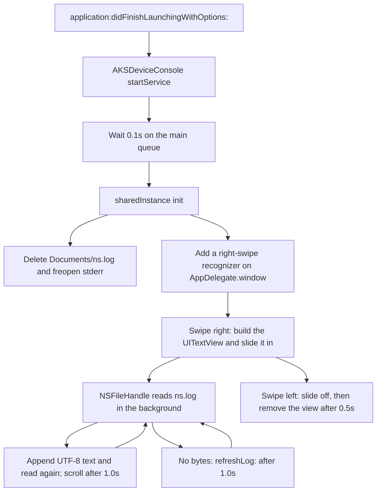
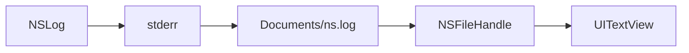

# AksDeviceConsole

iOS on-device console.


AksDeviceConsole is a small Objective-C iOS application that shows `stderr` output, including `NSLog`, on the device. At launch it deletes `Documents/ns.log`, redirects `stderr` onto that file, and attaches a right-swipe gesture to the window. Swiping right slides in a read-only text view that reads the log file. Swiping left on that text view slides it away. The sample view controller writes a few log lines every five seconds so the overlay has text to show.

## Features

- One public entry point, `+[AKSDeviceConsole startService]`, called from `application:didFinishLaunchingWithOptions:`.
- `stderr` is appended to `Documents/ns.log` with `freopen`. The file is removed when the shared console is created.
- A right swipe on `AppDelegate.window` shows the console. A left swipe on the text view hides it.
- The overlay is a non-editable `UITextView`: black background, white text, 10 pt system font, layer opacity `0.6`, added on the window and brought to the front.
- The panel slides in from the left over `0.30` seconds and slides off over `0.30` seconds. The view is removed `0.5` seconds after the hide animation starts.
- While the console is visible, an `NSFileHandle` reads `ns.log` from the start of the file and keeps reading on `NSFileHandleReadCompletionNotification`. Each chunk is decoded as UTF-8 and appended. The view scrolls to the end one second later.
- An empty read schedules `refreshLog:` after one second, which calls `readInBackgroundAndNotify` again, so later `NSLog` output still appears while the console is open.
- The service is a `dispatch_once` singleton, created on the main queue `0.1` seconds after `startService`.
- iPhone and iPad each have a nib. `AppDelegate` picks `ViewController_iPhone` or `ViewController_iPad` from the device idiom.
- The sample `ViewController` schedules a repeating `NSTimer` every `5` seconds and logs a short usage message.
- Automatic Reference Counting is on (`CLANG_ENABLE_OBJC_ARC = YES`).

## How it runs



`NSLog` writes to `stderr`. After `resetLogData`, that stream is the log file the text view reads:



`stderr` is redirected when the singleton is created, which is `0.1` seconds after `startService`. Output printed before that redirect is not in `ns.log`. Hiding the console removes the text view and the notification observer. It leaves the log file in place. The file is deleted only in `resetLogData`, which runs when the service starts.

## Requirements

Values below are the settings in this repository.

| Setting | Value |
| --- | --- |
| Language | Objective-C |
| Product | `AksDeviceConsole.app` (`com.apple.product-type.application`) |
| Base SDK | `iphoneos` |
| Deployment target | iOS 6.1 |
| Devices | iPhone and iPad (`TARGETED_DEVICE_FAMILY = 1,2`) |
| Required capability | `armv7` (`UIRequiredDeviceCapabilities`) |
| Linked frameworks | Foundation, UIKit, CoreGraphics, QuartzCore |
| Memory management | ARC |
| Prefix header | `AksDeviceConsole/AksDeviceConsole-Prefix.pch` (warns below the iOS 4.0 SDK) |
| Code signing | `iPhone Developer` for `iphoneos` |
| Bundle identifier | `com.kiplmobile24.${PRODUCT_NAME:rfc1034identifier}` |
| Version | `CFBundleShortVersionString` and `CFBundleVersion` `1.0` |
| Orientations | iPhone: portrait, landscape left, landscape right. iPad: those three plus portrait upside down |
| Localization | English (`en`) |
| Xcode project | `objectVersion` 46, `compatibilityVersion` Xcode 3.2, `LastUpgradeCheck` 0460 |
| Configurations | Debug (`DEBUG=1`) and Release (`-DNS_BLOCK_ASSERTIONS=1`). The default configuration name is Release |

The project has one application target and no test target. The checked-in scheme is `AksDeviceConsole` (`AksDeviceConsole.xcodeproj/xcuserdata/alok.xcuserdatad/xcschemes/AksDeviceConsole.xcscheme`). Run, test, and analyze use Debug. Profile and archive use Release.

## Installation

This repository is the Xcode project for the sample app. It contains no Podfile, podspec, `Package.swift`, or Cartfile.

1. Clone the repository.
2. Open `AksDeviceConsole.xcodeproj` in Xcode.
3. Build and run the `AksDeviceConsole` target. The scheme name in the repository is `AksDeviceConsole`.

`+[AKSDeviceConsole startService]` is implemented in this target. `AKSDeviceConsole.m` imports `AppDelegate.h` and reads the window through this macro:

```objc
#define APPDELEGATE ((AppDelegate *)[[UIApplication sharedApplication] delegate])
```

The gesture recognizer and the text view are added to `APPDELEGATE.window`. The sample's application delegate class is `AppDelegate`, and `main.m` passes that class to `UIApplicationMain`.

## Usage

The public header declares a single method:

```objc
@interface AKSDeviceConsole : NSObject
+ (void)startService;
@end
```

`AppDelegate` creates the window, installs the iPhone or iPad view controller, makes the window key and visible, then starts the console:

```objc
#import "AppDelegate.h"
#import "ViewController.h"
#import "AKSDeviceConsole.h"

- (BOOL)application:(UIApplication *)application didFinishLaunchingWithOptions:(NSDictionary *)launchOptions
{
    self.window = [[UIWindow alloc] initWithFrame:[[UIScreen mainScreen] bounds]];
    if ([[UIDevice currentDevice] userInterfaceIdiom] == UIUserInterfaceIdiomPhone) {
        self.viewController = [[ViewController alloc] initWithNibName:@"ViewController_iPhone" bundle:nil];
    } else {
        self.viewController = [[ViewController alloc] initWithNibName:@"ViewController_iPad" bundle:nil];
    }
    self.window.rootViewController = self.viewController;
    [self.window makeKeyAndVisible];

    [AKSDeviceConsole startService];

    return YES;
}
```

After launch:

1. Swipe right on the window. The console is created only when its text view is `nil`.
2. Read the log in the lower part of the screen. The frame is `CGRectMake(30, height - height / 3 - 60, width - 30, height / 3)`, using `[UIScreen mainScreen].bounds`.
3. Swipe left on the text view to hide it. A later right swipe creates a new text view and starts another background read of `ns.log` from the beginning of the file.

The sample screen has no controls. `ViewController` only logs on a five-second timer:

```objc
- (void)viewDidLoad {
    [super viewDidLoad];
    [NSTimer scheduledTimerWithTimeInterval:5 target:self selector:@selector(printTestData) userInfo:nil repeats:YES];
}

- (void)printTestData {
    NSLog(@"\n______________ON DEVICE CONSOLE__________");
    NSLog(@"all your device console text can be seen using this control");
    NSLog(@"swipe left and right to hide and show the console.");
    NSLog(@"Just write [AKSDeviceConsole startService] in didFinishLaunchingWithOptions\n");
    NSLog(@"Enjoy easy debugging\n");
}
```

The right-swipe recognizer shows the console. The left-swipe recognizer on the text view hides it. That matches the third sample line: swipe to hide and show.

## Project structure

```
.
├── LICENSE
├── README.md
├── AksDeviceConsole.xcodeproj
│   ├── project.pbxproj
│   ├── project.xcworkspace
│   └── xcuserdata/alok.xcuserdatad/xcschemes/AksDeviceConsole.xcscheme
└── AksDeviceConsole
    ├── AKSDeviceConsole.h          Public startService declaration
    ├── AKSDeviceConsole.m          Log file, gestures, overlay, file tail
    ├── AppDelegate.h
    ├── AppDelegate.m               Window setup and startService
    ├── ViewController.h
    ├── ViewController.m            Five-second sample NSLog timer
    ├── main.m
    ├── AksDeviceConsole-Info.plist Bundle id, version, orientations, armv7
    ├── AksDeviceConsole-Prefix.pch
    ├── Default.png                 Launch images
    ├── Default@2x.png
    ├── Default-568h@2x.png
    └── en.lproj
        ├── InfoPlist.strings
        ├── ViewController_iPhone.xib
        └── ViewController_iPad.xib
```

The class is spelled `AKSDeviceConsole`. The target, product, and project are spelled `AksDeviceConsole`. The Xcode organization name in the project is Konstant Info Private Limited. File headers on the app sources say they were created by Alok on 02/09/13.

## Customisation

There is no settings plist and no public property for the console. The behaviour above is hardcoded in `AksDeviceConsole.m` and in the sample view controller. Change these in source:

| What | Where | Current value |
| --- | --- | --- |
| Log file name | `AKS_LOG_FILE_PATH` in `AKSDeviceConsole.m` | `Documents/ns.log` |
| Startup delay | `startService` | `0.1` seconds, then `sharedInstance` on the main queue |
| Show gesture | `addGestureRecogniser` | `UISwipeGestureRecognizerDirectionRight` on the window |
| Hide gesture | `showConsole` | `UISwipeGestureRecognizerDirectionLeft` on the text view |
| Panel frame | `showConsole` | x `30`, y `height - height / 3 - 60`, width `width - 30`, height `height / 3` |
| Colours and type | `showConsole` | Black background, white text, system font size `10`, not editable, opacity `0.6` |
| Show animation | `moveThisViewTowardsLeftToRight:duration:` | `0.30` seconds |
| Hide animation | `hideWithAnimation` | `0.30` seconds, then `hideConsole` after `0.5` seconds |
| Scroll delay | `getData:` | `1.0` seconds |
| Idle read retry | `getData:` / `refreshLog:` | `1.0` seconds |
| Sample log interval | `ViewController viewDidLoad` | `5` seconds, repeating |

`AppDelegate` window setup and the phone/pad nib choice are the launch customisation in this sample. Bundle identifier, version, and orientations live in `AksDeviceConsole/AksDeviceConsole-Info.plist`. Deployment target, device family, and the code-sign identity live in `AksDeviceConsole.xcodeproj/project.pbxproj`.

## Contributing

Issues and pull requests are welcome on [github.com/aryansbtloe/AksDeviceConsole](https://github.com/aryansbtloe/AksDeviceConsole). Branch from `master`, keep the change focused, and open a pull request against `master`.

The Xcode project has no test target. Describe how you ran the `AksDeviceConsole` scheme, and what the right-swipe console showed, when the change affects logging or the overlay.

## License

This repository is licensed under the MIT License. See [LICENSE](LICENSE).

Copyright (c) 2026 Alok Singh.

`AKSDeviceConsole.h` and `AKSDeviceConsole.m` also carry the MIT permission text with the header line `Copyright (c) 2013 Konstant Info Private Limited`. The same 2013 Konstant Info Private Limited copyright line is in `AppDelegate`, `ViewController`, and `main.m`.

## Author

**Alok Singh**

- GitHub: [https://github.com/aryansbtloe](https://github.com/aryansbtloe)
- Website: [https://bestlatestapps.com](https://bestlatestapps.com)
